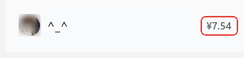
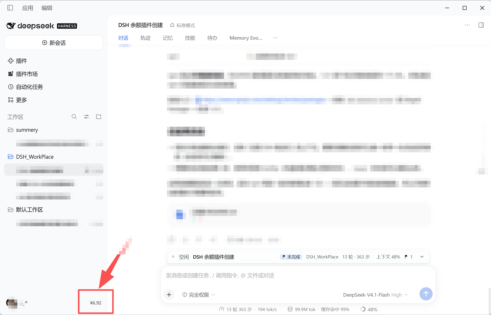

# dsh-balance-corner

DeepSeek 账号余额显示在侧边栏左下角账号行的最右端——只显示金额，例如 `¥43.52`。

A DeepSeek account balance in the bottom-left account row of the DSH sidebar. One amount, no label.



在 DSH 里的整体位置（红框处就是余额；对话内容与头像已打码）：



## 它是什么

- **位置**：侧边栏页脚、账号（头像）那一行的最右端，和头像同一行。
- **内容**：充值余额（人民币优先，没有人民币时显示第一个钱包）。
- **悬停**：充值余额、赠金余额、更新时间；余额不足时提示去充值，正常时提示点击查看用量。
- **点击**：在右侧内置浏览器打开平台用量页；余额不足时打开充值页；读取失败时点击表示重试。
- **< 5 元**：金额变黄，点击直接去充值。
- **不显示**：账号未登录，或当前用的是 API Key 而不是 DeepSeek 账号；侧边栏收成窄栏时也不显示。

## 安装

```sh
dsh plugin add dsh-balance-corner
```

或在桌面端/市场的插件页里搜 `dsh-balance-corner` 安装。装完刷新页面。

依赖 DSH 0.2.2 系列（`engines.dsh: ^0.2.2-rc.1`），需要登录 DeepSeek 账号；用 API Key 的配置不会显示余额——那部分没有账号余额可读。

## 数据从哪来

走 DSH 自己的账号服务 `remote.account.getBalance`，也就是「设置 → 账号」用的同一条通路：请求由 Host 发出，用本机已登录的账号授权，页面里不保存也不传输任何密钥；Host 只把平台返回的 `normal_wallets` / `bonus_wallets` 的币种和余额字符串投影给页面。

刷新：打开时读一次、每 2 分钟一次、窗口重新聚焦时（上次读取超过 1 分钟）、以及任一会话有活动时（最多每 30 秒一次）。

## 实现说明（会改 DSH 内部结构的人看）

- 宿主槽位 `sidebar.footer.action` 只用来拿一个稳定的挂载点；芯片本身用 `react-dom` 的 `createPortal` 挂到账号行元素末尾（`[class*="_triggerRow"]`，退化为 `button[aria-haspopup="dialog"]` 的父元素），因为账号行是 shell 写死的 `[设置触发器][连接指示灯][更新角标]`，没有尾部插槽。
- 账号行会被 shell 重渲染替换，组件每 2 秒检查挂载点是否还连着 DOM，掉了就重挂；一直找不到就退回显示在页脚行。
- 客户端插件访问 Remote 必须同时注入 `remote` 和 `remote.account`，否则会报 `cannot get property "remote" without inject`。
- 因此这个插件对 DSH 的账号行 DOM 结构有依赖。将来大改版若换了结构，它会退回页脚显示而不是消失。

## 边界

- 只能显示，不能充值：真正的充值仍在平台页面完成。
- 余额是平台「用量」页的充值余额，不是 token 计数；赠金单独统计，不计入充值余额。
- 未声明数据收集：插件不发遥测，只调用 `remote.account` 读余额与账号状态。

## License

MIT
